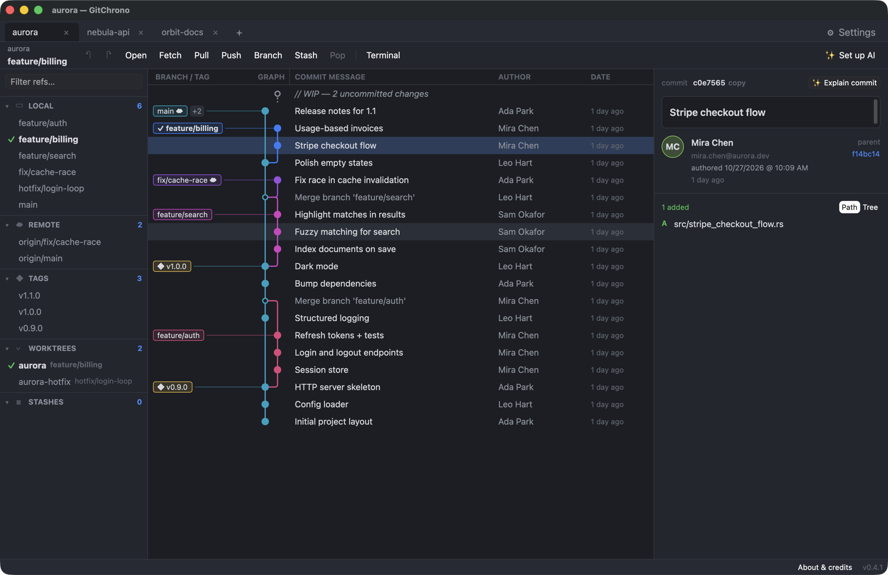
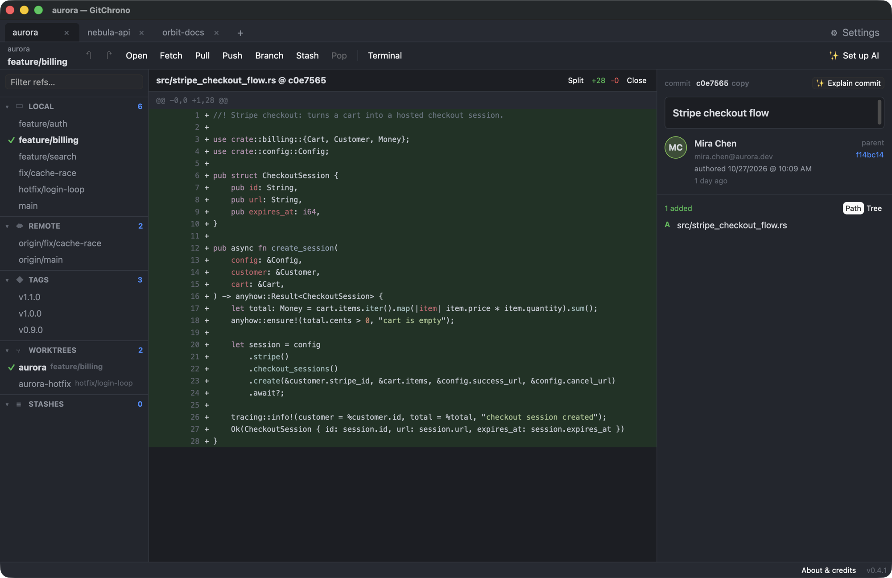
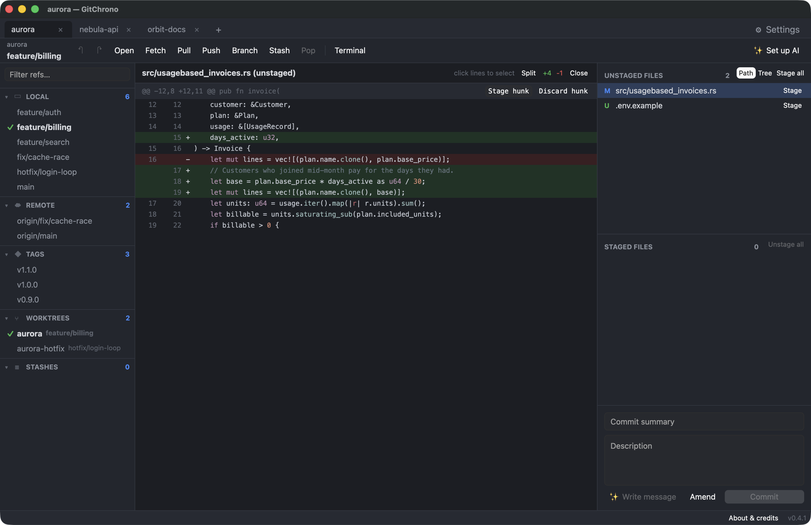
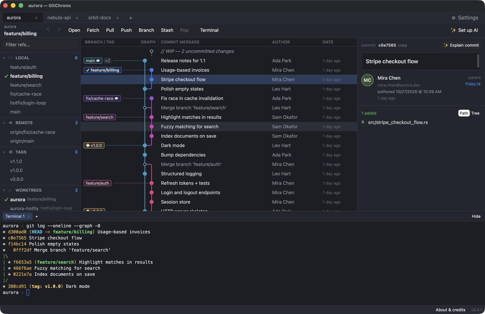
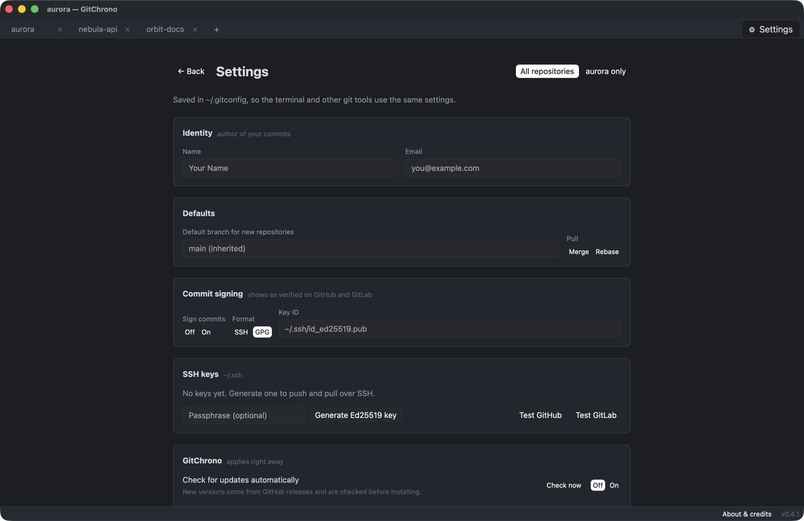

# GitChrono

A fast, native Git client — 100% Rust, GPU-rendered with
[gpui](https://gpui-kit.com).



<table>
  <tr>
    <td width="50%"></td>
    <td width="50%"></td>
  </tr>
  <tr>
    <td width="50%"></td>
    <td width="50%"></td>
  </tr>
</table>

> [!WARNING]
> **GitChrono is in alpha. Use at your own risk.** Expect bugs and breaking changes.
> It runs real git commands (reset, rebase, discard, force-push) on your repositories,
> so keep backups or a pushed remote of anything you can't afford to lose.

```bash
cargo run -p gitchrono-app -- /path/to/repo     # or open one from the welcome screen
```

Requires `git` 2.40+ on `PATH` (Windows builds include MinGit as a fallback; without git the app shows how to install it).

## Architecture

```
crates/
  gitchrono-core/   git engine — reads via gitoxide, writes via the git CLI
  gitchrono-graph/  pure commit-graph lane layout (unit tested)
  gitchrono-app/    gpui desktop app (gpui-kit + gpui-component)
```

**Hybrid engine.** History walk (`--topo-order`), refs and commit trees come from
[gitoxide](https://github.com/GitoxideLabs/gitoxide) — that's what keeps 85k-commit repos
fast. Everything that mutates the repo (commit, push, rebase, stash, …) and porcelain-exact
reads (status, patches) shell out to `git`, so hooks, credential helpers, SSH config and
signing behave exactly like the terminal. As gix grows (push/rebase are still missing upstream)
more can move in-process.

Benchmark: `cargo run --release -p gitchrono-core --example snapshot -- <repo>`
(git.git: 85,767 commits loaded in ~2.8s, graph layout ~80ms, Apple Silicon).

**Debug hooks.** `GITCHRONO_SETTINGS=1` opens the settings page on launch; `GITCHRONO_FOLDERS=1` starts file lists in folder view. `GITCHRONO_SELECT=<row>[:diff]` selects a row (and opens its first diff)
after the first load and `GITCHRONO_TERMINAL=<command>` runs a command in the terminal — used by `scripts/screenshots.sh`.

## Releases

Builds run on GitHub Actions:

- **CI** (`.github/workflows/ci.yml`) — tests + app build on macOS, Linux and Windows for every push/PR.
- **Release** (`.github/workflows/release.yml`) — on a `v*` tag, builds and publishes a GitHub Release:
  macOS universal `.dmg`, Windows x64 `.zip`, Linux x64/arm64 `.tar.gz`, plus `SHA256SUMS.txt`.
  The version comes from the tag; `-suffix` tags are marked pre-release. Run it manually
  (workflow_dispatch) or push a `release/**` branch to get `-dev.N` artifacts without publishing.
- **Screenshots** (`.github/workflows/screenshots.yml`) — on a `v*` tag (or manually), takes the
  screenshots above on macOS with `scripts/screenshots.sh` and commits them to `docs/screenshots/`
  when they changed. Run the script locally to preview them (it needs Screen Recording permission).

```bash
scripts/release.sh 0.2.0 --push   # bump Cargo version, commit, tag v0.2.0, push → release
```

macOS builds are ad-hoc signed; Gatekeeper will warn until Developer ID signing +
notarization secrets are added. Windows builds are unsigned.

## Licensing (open-core)

The crates in this repository are Apache-2.0. Paid Pro features (hosted integrations,
team features, AI) will live in a separate crate outside this repo.

See [docs/roadmap.md](docs/roadmap.md) for the roadmap.
